<picture>
  <source media="(prefers-color-scheme: dark)" srcset="https://raw.githubusercontent.com/john-liu-dev/john-liu-dev/main/assets/banner-dark.svg">
  
</picture>

I work on LLM and agentic inference: making models answer faster and agents wait less. I also keep an eye on what people build with agents.

做LLM和Agentic推理优化，让模型答得快一点、agent少等一会儿，也关注agent应用

**Now** · multimodal serving (Qwen3-VL video) on Dynamo + TensorRT-LLM · encode / prefill / decode disaggregation · KV-aware decode routing · agentic workloads

**Side project** · [HackerShelf](https://john-liu-dev.github.io/shelf/) · papers and free books Hacker News kept recommending over 20 years, with Chinese reading guides · [how it's built](https://github.com/john-liu-dev/open-hackershelf)

#### Writing

<!-- BLOG-POST-LIST:START -->
- *Pending — the first posts are in the works.*
<!-- BLOG-POST-LIST:END -->

#### Upstream field notes

**Merged PRs**

- **Merged** · **[AIPerf#1766](https://github.com/ai-dynamo/aiperf/pull/1766)** · replay synthetic images and videos across DAG branches.
- **Merged** · **[Dynamo#18600](https://github.com/ai-dynamo/dynamo/pull/18600)** · use uint8 frames for video-only requests when the model expects NumPy video ([issue #18599](https://github.com/ai-dynamo/dynamo/issues/18599)).
- **Merged** · **[Dynamo#18442](https://github.com/ai-dynamo/dynamo/pull/18442)** · Qwen3-VL image + video input ([issue #18441](https://github.com/ai-dynamo/dynamo/issues/18441)).
- **Merged** · **[Dynamo#17943](https://github.com/ai-dynamo/dynamo/pull/17943)** · remove unused LLaVA transceiver config ([related issue #17015](https://github.com/ai-dynamo/dynamo/issues/17015)).

**Open work & reports**

- Open PR · [Dynamo#18224](https://github.com/ai-dynamo/dynamo/pull/18224) KV-capacity routing ([issue #18223](https://github.com/ai-dynamo/dynamo/issues/18223)).
- Reported · **Fixed upstream** · [TRT-LLM#20138](https://github.com/NVIDIA/TensorRT-LLM/issues/20138) native Python video E/PD layout ([fix #20497](https://github.com/NVIDIA/TensorRT-LLM/pull/20497)).

[Merged PRs](https://github.com/search?q=is%3Apr%20is%3Amerged%20author%3Ajohn-liu-dev%20-user%3Ajohn-liu-dev%20is%3Apublic%20sort%3Acreated-desc&type=pullrequests) · [All PRs](https://github.com/search?q=is%3Apr%20author%3Ajohn-liu-dev%20-user%3Ajohn-liu-dev%20is%3Apublic%20sort%3Acreated-desc&type=pullrequests) · [All issues](https://github.com/search?q=is%3Aissue%20author%3Ajohn-liu-dev%20-user%3Ajohn-liu-dev%20is%3Apublic%20sort%3Acreated-desc&type=issues)

Full contribution list

**Pull requests**

- **Merged · 2026-11-28 (UTC+8)** · [AIPerf#1766](https://github.com/ai-dynamo/aiperf/pull/1766) — replay the same synthetic images and videos across turns and branches in `dag_jsonl` benchmarks.
- **Merged · 2026-11-25 (UTC+8)** · [Dynamo#18600](https://github.com/ai-dynamo/dynamo/pull/18600) — use uint8 frames for video-only requests when the model expects NumPy video ([issue #18599](https://github.com/ai-dynamo/dynamo/issues/18599); closed).
- **Merged · 2026-11-11 (UTC+8)** · [Dynamo#18442](https://github.com/ai-dynamo/dynamo/pull/18442) — mixed image/video requests ([issue #18441](https://github.com/ai-dynamo/dynamo/issues/18441); closed).
- **Merged · 2026-11-11 (UTC+8)** · [Dynamo#17943](https://github.com/ai-dynamo/dynamo/pull/17943) — unused LLaVA transceiver config ([issue #17015](https://github.com/ai-dynamo/dynamo/issues/17015); closed).
- Open PR · [Dynamo#19016](https://github.com/ai-dynamo/dynamo/pull/19016) — idempotent FileStore delete ([issue #19014](https://github.com/ai-dynamo/dynamo/issues/19014); open).
- Open PR · [Dynamo#19013](https://github.com/ai-dynamo/dynamo/pull/19013) — Mocker `--speedup-ratio 0` timing docs ([issue #19012](https://github.com/ai-dynamo/dynamo/issues/19012); open).
- Open PR · [Dynamo#19011](https://github.com/ai-dynamo/dynamo/pull/19011) — contributor label links ([issue #19007](https://github.com/ai-dynamo/dynamo/issues/19007); open).
- Open PR · [Dynamo#18224](https://github.com/ai-dynamo/dynamo/pull/18224) — KV-capacity-aware decode selection ([issue #18223](https://github.com/ai-dynamo/dynamo/issues/18223); open).
- Closed, not merged · [Dynamo#17016](https://github.com/ai-dynamo/dynamo/pull/17016) — Qwen3-VL transceiver config ([issue #17015](https://github.com/ai-dynamo/dynamo/issues/17015); closed).

**Additional reports**

- Open issue · [Dynamo#16768](https://github.com/ai-dynamo/dynamo/issues/16768) — multimodal preprocessing blocks token streaming.
- Open issue · [Dynamo#16156](https://github.com/ai-dynamo/dynamo/issues/16156) — synthetic-video overflow with NumPy 2.
- Open issue · [TRT-LLM#20141](https://github.com/NVIDIA/TensorRT-LLM/issues/20141) — video sampling and timestamp metadata.
- Open issue · [Dynamo#16155](https://github.com/ai-dynamo/dynamo/issues/16155) — encode-worker request-ack timeout.
- Open issue · [Dynamo#16154](https://github.com/ai-dynamo/dynamo/issues/16154) — redundant decode-side video processing.
- **Fixed upstream · 2026-11-13 (UTC+8)** · [TRT-LLM#20138](https://github.com/NVIDIA/TensorRT-LLM/issues/20138) — video timestamps and frame markers in native Python E/PD ([upstream fix #20497](https://github.com/NVIDIA/TensorRT-LLM/pull/20497)).

[NVIDIA 博客作者页](https://blogs.nvidia.cn/blog/author/liujohn/) · Views are my own.
