<picture>
  <source media="(prefers-color-scheme: dark)" srcset="https://raw.githubusercontent.com/john-liu-dev/john-liu-dev/main/assets/banner-dark.svg">
  
</picture>

I work on LLM and agentic inference at NVIDIA: making models answer faster and agents wait less. I also keep an eye on what people build with agents.

做LLM和Agentic推理优化，让模型答得快一点、agent少等一会儿，也关注agent应用

**Now** · multimodal serving (Qwen3-VL video) on Dynamo + TensorRT-LLM · encode / prefill / decode disaggregation · KV-aware decode routing · agentic workloads

#### Writing

<!-- BLOG-POST-LIST:START -->
- *Pending — the first posts are in the works.*
<!-- BLOG-POST-LIST:END -->

#### Upstream field notes

PRs and issues from multimodal, disaggregated serving and KV-aware routing.

- [ai-dynamo/dynamo#18224](https://github.com/ai-dynamo/dynamo/pull/18224) · draft: opt-in decode routing that prefers DP ranks with enough KV capacity for the request ([issue #18223](https://github.com/ai-dynamo/dynamo/issues/18223))
- [ai-dynamo/dynamo#17943](https://github.com/ai-dynamo/dynamo/pull/17943) · fix: drop `cache_transceiver_config` from the LLaVA TRT-LLM aggregated config
- [ai-dynamo/dynamo#16768](https://github.com/ai-dynamo/dynamo/issues/16768) · multimodal preprocessing on the worker event loop freezes token streaming
- [ai-dynamo/dynamo#16154](https://github.com/ai-dynamo/dynamo/issues/16154) · PD disaggregation: the decode worker re-loads and re-encodes every `video_url`
- [NVIDIA/TensorRT-LLM#20138](https://github.com/NVIDIA/TensorRT-LLM/issues/20138) · Qwen3-VL E/PD handoff drops per-frame timestamp tokens for video
- [NVIDIA/TensorRT-LLM#20141](https://github.com/NVIDIA/TensorRT-LLM/issues/20141) · Qwen3-VL: `total_num_frames` is rewritten without rescaling fps

[NVIDIA 博客作者页](https://blogs.nvidia.cn/blog/author/liujohn/) · Views are my own.
